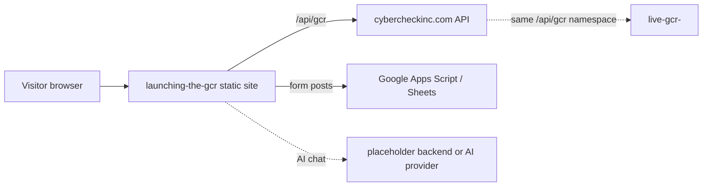

# launching-the-gcr

The older, browser-only version of the Gulf Coast Radar (GCR) tourist website: plain HTML, CSS and JavaScript, packaged for Vercel.

## What it is

A large static site where visitors browse Orange Beach and Gulf Shores restaurants, things to do, events, specials, weather and beach flags, with an AI chat assistant and a profile area. Business data is embedded in the front end rather than served by an API, which makes it an earlier generation than the API-backed GCR apps.

## How it works

- No `package.json` and no build step. Pages: `index.html` (about 2,900 lines), `profile.html`, `restaurants.html`, `things-to-do.html`. Styles in `css/` (26 files), scripts in `js/` (82 files).
- Business data is bundled in `js/data.js` and `data/restaurants-with-specials.json`. `js/data-loader.js` can override it from browser `localStorage` (`gcr_business_data`).
- `js/cybercheck-integration.js` and `js/feed-api.js` call `https://cybercheckinc.com/api/gcr`.
- `js/signup-form.js` and `js/claim-page-form.js` post form data to a Google Apps Script web app (Google Sheets).
- AI assistant: `js/ai-assistant.js`, `ai-backend.js`, `ai-multi-agent.js`, `ai-order-parser.js`, `tts-voice-manager.js`. `ai-backend.js` targets a placeholder backend URL (`your-backend-url.com`) or an AI provider directly from the browser.
- Ordering, payment and booking modules (`square-integration.js`, `pos-integrations.js`, `payment-handler.js`, `reservation-manager.js`, `order-manager.js`) are integration stubs.
- Admin login (`js/admin-auth.js`) is client-side only, so it protects nothing.
- Incomplete: `index.html` references files that are not in the repo, including `data/data.js`, `data/services-and-attractions.js`, `data/beach-conditions.js`, `manifest.json`, `admin.html` and `specials.html`, so those scripts and links 404.

## Run it

```sh
python3 -m http.server 8000     # from the repo root, then open http://localhost:8000
```

There is no install step and no environment variables. Expect broken widgets where files are missing and no working AI chat without a backend.

## Status

Stalled: the large legacy static GCR site, incomplete and superseded by the API-backed apps.

## Where it fits



## Related repos

- live-gcr-: serves the same `/api/gcr` API namespace this site calls.
- launching-gcr, gcr-unified and the Trip Swipe repos: other GCR front-end generations that overlap with this one.
- restaurant-menu-editor: its root folder holds a similar copy of the GCR pages and `js/` files.
